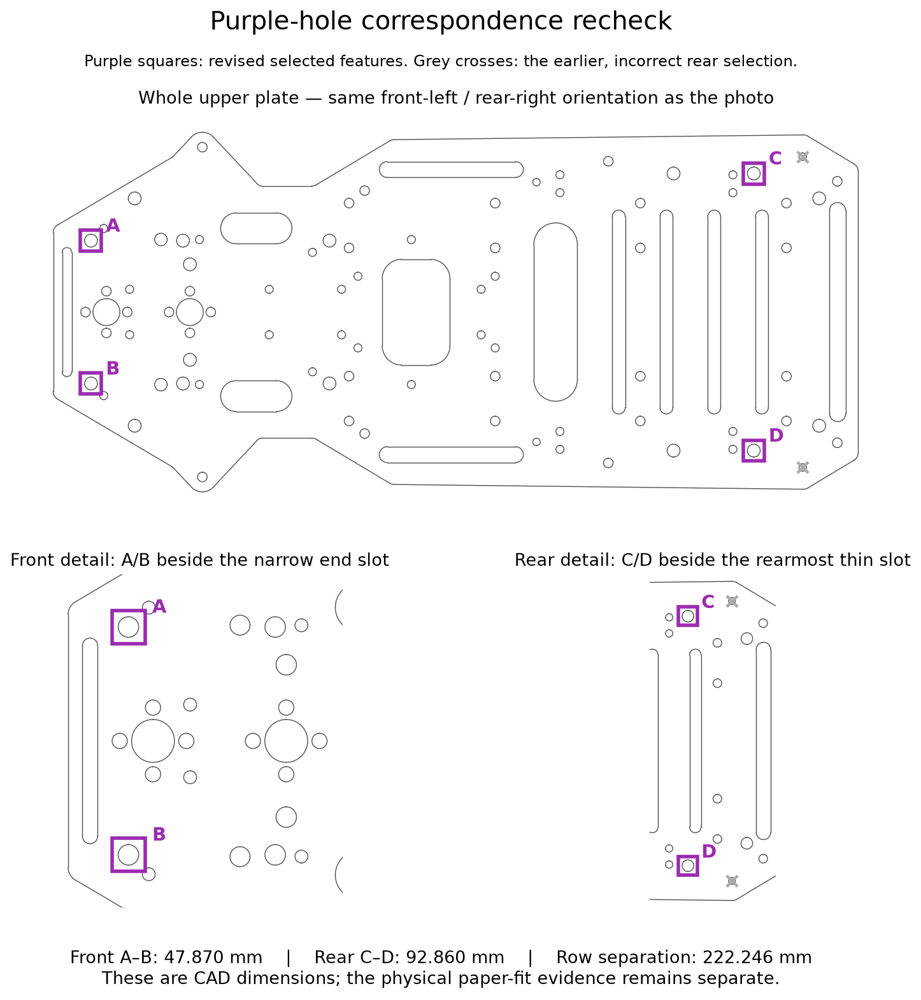
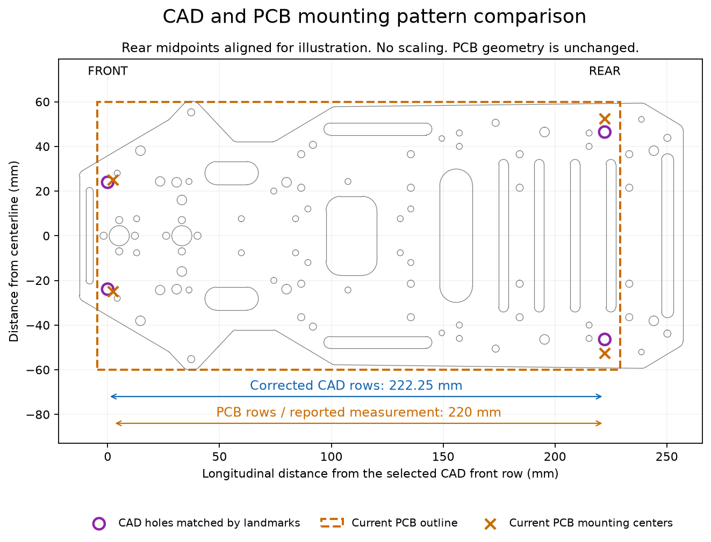

# Chassis reference comparison — October 28

We kept the current **120 × 234 mm PCB** and its **50 / 105 / 220 mm support
pattern** unchanged. The team reported that all four holes in its 1:1 paper
template aligned simultaneously on the physical chassis. That completed fit
check remains evidence. The downloaded chassis model does not independently
confirm the same pattern, so we cannot yet claim a matching CAD assembly.

## Source and correspondence

**Correction after the purple-hole recheck:** the earlier rear selection was
too far rearward. Its 238.650 mm row separation and 2.5 mm rear-hole diameter
do not describe the purple-marked pair. We replaced those features with the
larger pair beside the rearmost thin slot. The front selection is retained
after checking the narrow end slot, large centre hole and nearby small holes.

Canvas lists [Ackermann Chassis (Single Layer).3dm](https://canvas.cmu.edu/courses/56453/files/14985787)
in the course Labs folder, created and last modified October 9, 2026. Its
displayed 185.5 MB size agrees with the downloaded file's 185,526,936 bytes.
The file page provides no revision explanation. Despite its name, the model
contains both chassis plates, spacers, wheels and steering parts. Its units
are millimetres, with 0.001 mm model tolerance.

We matched the front pair beside the narrow end slot and the rear pair beside
the rearmost thin slot by their locations
in the [marked team photo](measurements/chassis-mounting-2026-10-23.jpg).
That correspondence is a visual interpretation, not confirmation that this
CAD revision describes our actual car.

| Dimension | Team evidence / saved PCB | Visually corresponding CAD features |
| --- | ---: | ---: |
| Front pair, centre to centre | 50 mm | 47.870 mm |
| Rear pair, centre to centre | 105 mm | 92.860 mm |
| Front-to-rear row separation | 220 mm | 222.246 mm |
| Chassis hole diameters | 4.5 mm, reported smooth holes | 4.3 mm at all four selected CAD holes |
| Clear space between chassis plates | Approximately 51.75 mm reported | 50.000 mm |

The corrected longitudinal spacing is much closer to the recorded 220 mm,
but the 12.140 mm difference in rear-pair width still prevents a matching
four-hole CAD assembly. These values describe the model; they do not replace
the team's physical measurements. We have not established whether the
remaining difference comes from a different chassis revision, remaining
feature correspondence ambiguity, or the tested template's recorded dimensions.

A/B identify the front pair; C/D identify the revised rear pair. Grey crosses
mark the earlier, incorrect rear selection. This figure makes the visual
correspondence reviewable without needing another set of physical measurements.

The illustration aligns the rear-pair midpoints and applies no scale change.
It is a reference comparison, not a fitted assembly. Purple circles identify
the selected CAD features; orange crosses show the current PCB hole centres.

## Checks and reproducibility

The upper plate is object `520c3531-3412-40e6-9cf7-20c65621038d`, object index
36 in the downloaded model. Its top surface is at Z = 81.117693 mm.
The selected hole centres in model coordinates are:

| Pair | Left X / Y (mm) | Right X / Y (mm) | Boundary-edge indices |
| --- | --- | --- | --- |
| Front | −21.45269 / −125.71958 | 26.41721 / −125.71958 | 490; 493 |
| Rear | −43.94773 / 96.52639 | 48.91225 / 96.52639 | 196; 199 |

We extracted circular boundary arcs at the top surface using the model's
0.001 mm tolerance, joining arcs with the same centre and radius. The check
found 83 complete circular holes. Across 72 horizontal pairs and 2,442
front/rear pair combinations, none exactly matched the PCB pattern under
translation without scaling. The closest alternative uses a different front
row and has 215.200 mm row separation; its largest residual hole-centre error
after translation is 2.494 mm. This search covers horizontal circular-hole
pairs, not slots, tilted supports or a complete steering sweep.

The saved KiCad PCB independently gives H1/H2 at (47.5, 47) / (152.5, 47) mm
and H3/H4 at (75, 267) / (125, 267) mm: 105 mm rear, 50 mm front and 220 mm
between rows. Their PCB drills are 3.2 mm. These are PCB holes, distinct from
the reported 4.5 mm chassis holes. The outline dimensions use the Edge.Cuts
centreline, excluding its display stroke width.

The October 28 native checks on the unchanged board reported zero ERC
findings, DRC violations, unconnected items and schematic-parity findings
under the current project settings. There are 287 electrical footprints,
19,513 track/via items and six copper zones. Those results do not qualify the
chassis fit or the remaining power/thermal/purchasing decisions.

Exact extracted values, source hashes and the alternative-pair search result
are in [Chassis-CAD-check.json](Chassis-CAD-check.json). The CAD SHA-256 is
`b83c36c1d7df816716110a03a9ffe05b44c7aa64c3f3ca3b1ee18c2b124bd11c`.
The unchanged PCB SHA-256 is
`bfb2a79c938132977b585de41a2e6a9b5692a69b79abc8722c8597397bc7b0c3`.
The large course CAD file is not duplicated in this repository.

## Before release

Review the labelled A/B/C/D correspondence before treating the course model
as verification of the mounting pattern. If these are the intended matching
features, the remaining focused reference question is:

> Our 1:1 template fits the car using 50/105 mm front/rear pair spacing and
> 220 mm between rows. The labelled matching features in the Canvas model
> give 47.87/92.86 mm and 222.25 mm. Does that model represent the same chassis
> revision? Can we use the mounting pattern already checked on our actual car?

Attach the comparison and the existing fit photo when asking. If the model
is confirmed to represent a different car, retain the documented physical
fit as the mounting evidence. If it is confirmed to be the same revision,
identify the corresponding holes and reconcile the exact template used
before changing or releasing CAD. Do not stretch the model or move the PCB
holes merely to force numerical agreement. No new component-placement,
height or steering-clearance guarantee is inferred from this unresolved
registration.
