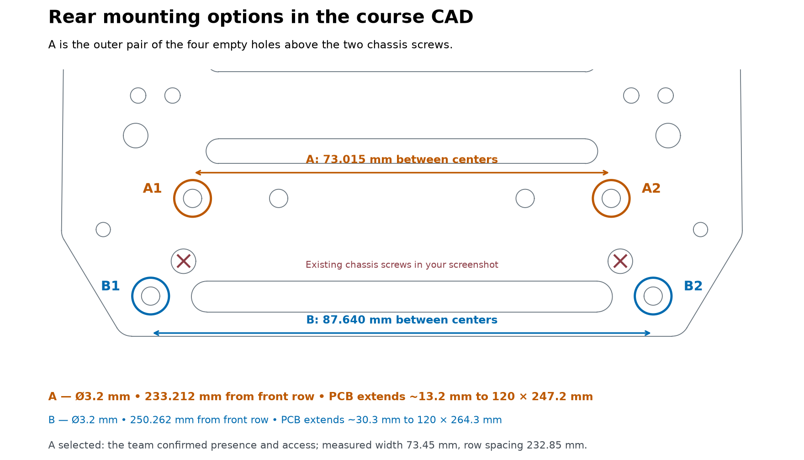

# Chassis CAD and selected supports — October 28

We use the CAD front pair at **47.870 mm** and newly verified rear pair **A1/A2 at 73.01493 mm**, separated longitudinally by **233.21155 mm**. The team confirmed A1/A2 are present, unused and accessible on the actual chassis. Measurements of approximately 48 mm front, 73.45 mm rear and 232.85 mm straight row separation support this selection; the user chose CAD nominal values.

## Source

[Ackermann Chassis (Single Layer).3dm on Canvas](https://canvas.cmu.edu/courses/56453/files/14985787) is 185,526,936 bytes, SHA-256 b83c36c1d7df816716110a03a9ffe05b44c7aa64c3f3ca3b1ee18c2b124bd11c. Its units are millimetres and model tolerance is 0.001 mm. The upper plate is object 520c3531-3412-40e6-9cf7-20c65621038d (index 36), with its top surface at Z=81.117693 mm. We extracted circular boundary arcs at that surface, joining arcs with the same centre and radius, and identified 83 complete circular holes. The large course model is not duplicated in Git.

| Pair | Left model X/Y (mm) | Right model X/Y (mm) | Diameter; edge indices |
| --- | --- | --- | --- |
| Front | −21.45269 / −125.71958 | 26.41721 / −125.71958 | 4.3 mm; 490 / 493 |
| Rear A1/A2 | −34.02520 / 107.49197 | 38.98973 / 107.49197 | 3.2 mm; 412 / 406 |

Transform: PCB X = 100 + model X − 2.48226; PCB Y = 267 − (model Y + 125.71958). Front width is rounded from 47.86990 to the requested 47.87000 mm about X=100.

## Why this rear pair

| Option | Width / row separation | Consequence |
| --- | --- | --- |
| **A1/A2, selected** | 73.015 / 233.212 mm | 3.2 mm chassis holes for M3; extend PCB 13.212 mm; no existing part or trace relocation |
| B1/B2, farther rearward | 87.640 / 250.262 mm | Also 3.2 mm, but needs a 30.262 mm extension |
| Near old rear row | 92.860 / 222.246 mm | Left support exclusion intersects HS80's reserved space |
| Adjacent smaller pairs | 91.995 or 80.005 / 215.251 mm | 2.7 mm holes; interfere with power components and copper |
| Existing chassis screw pair | 76.183 / 244.180 mm | Occupied in the supplied screenshot; not selected |

The selected outline is **120 × 247.21155 mm**, with rear supports 7 mm from its new edge. The 4 mm PCB drills and 4 mm hole-edge exclusions give 6 mm clear radii. Those rear circles lie entirely outside the former outline. Details are in [Mounting-tolerance-revision.md](Mounting-tolerance-revision.md).

## Evidence limits and superseded comparison

The earlier 238.650 mm result selected the wrong rear features. The subsequent 92.860/222.246 mm correspondence also differed from the old physical rear pair. Neither defines A1/A2. [Chassis-CAD-check.json](Chassis-CAD-check.json) retains that historical comparison; [Rear-mounting-selection.json](Rear-mounting-selection.json) records the current choice.

The previous four-hole cardboard fit used the old pattern. This selection has direct measurements and accessibility confirmation, but no claim of a completed rigid-PCB fit. DRC and exclusion checks establish saved layout geometry, not assembly retention or electrical performance.
